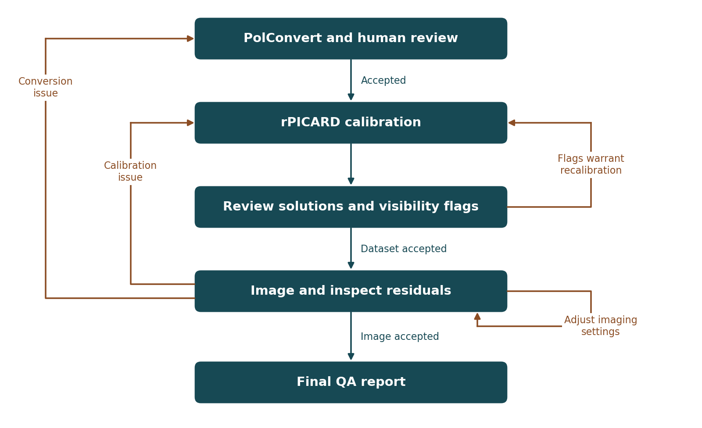

# EHT reduction workspace

This project keeps shared analysis tools alongside local observations. Open the project root in Codex so a new chat can find both. To share the workflow on GitHub, include this README, AGENTS.md, `tools/` and `Codex_skills/`. Each analyzer supplies their observation data locally.

## Reduction workflow

For each track and band, PolConvert converts the polarization basis of the correlated data, then rPICARD calibrates the visibilities. Codex assesses the products and proposes flags. A human reviews the conversion, calibration, and visibility selections. Before imaging, apply and verify any agreed visibility flags on the intended measurement set and record the dataset used. The final QA report combines the stage findings with the accepted image, restoring beam, and residual RMS. See the [full reduction workflow](tools/instructions/Markdowns/flaggings/Overall_workflow.md).



## Directory structure

| Path | Purpose |
|---|---|
| `Codex_skills/eht-reduction/SKILL.md` | Distributable Codex skill. It locates the guides and programs in the checkout. |
| `tools/instructions/Markdowns/AI_advices/` | [Evidence and exact input edits for human-reviewed rPICARD reruns](tools/instructions/Markdowns/AI_advices/rpicard_rerun_advice.md). |
| `tools/instructions/Markdowns/flaggings/` | Procedures for delay, bandpass, visibility inspection and the staged visibility flag review. |
| `tools/instructions/PDFs/`, `tools/instructions/examples/` | Workshop and inspection slides, and example calibration reports. |
| `tools/ancillary_py_codes/visibility/` | Shared visibility readers, checkpoint collectors, plotting and verification scripts. See the [code index](tools/ancillary_py_codes/README.md) for dependencies and commands. When following its shell examples, set the tools variable to the current checkout's `tools/ancillary_py_codes/visibility`. |
| `tools/ancillary_py_codes/visflag_widget/` | Interactive review application, requirements, tests and [run instructions](tools/ancillary_py_codes/visflag_widget/README.md). |
| `tools/ancillary_py_codes/workflow_test/` | Historical M87 workflow-test drivers with observation-specific assumptions. |
| `data/Polconv_2026/` | PolConvert materials for the 2026 observation. |
| `data/rpicard/e26m17/b1/` through `b4/` | Local per-band working directories. |
| `data/rpicard/e26m17_example/` | Reference reduction, separate workflow test and backup. The example observation is `e26m17_rpicard/e26m17-1-b3/` beneath this directory. |

Keep observation inputs with their reduction run. Use its `inspection/` folder for checkpoints and the handoff. The current visibility workflow writes its proposal PDF and ASCII commands directly in the selected data directory. Treat example measurements and flag selections as specific to their observation.

## Delay and passband flag review

Use the [delay and passband flagging guide](tools/instructions/Markdowns/flaggings/delaypassbandflag_guide.md) to prepare proposals and launch both human review passes. In the delay widget, a partially flagged scan still shows phase wherever the same hand and SPW have finite, unflagged phase and delay. Panel labels identify the affected hands and SPWs. Load the complex and scalar passband tables together to compare phase and gain amplitude. Keep delay and passband lists separate and verify their selections on table copies before application.

## Visibility flag review

Follow the [visibility flagging workflow](tools/instructions/Markdowns/flaggings/visflag_guide.md) for the two stages and the [report guide](tools/instructions/Markdowns/flaggings/visibility_inspection_guide.md) for figure layout.

1. Codex inspects the requested observation and writes `<target>_Codexflag_summary.pdf` and `<target>_Codexflag_commands.py` alongside the data. The report presents antenna-based time effects first, antenna-based frequency effects next, then other flag evidence and the residual survey.
2. The human reviewer opens the proposed ASCII list in the widget and writes `<target>_Codexflag_commands_approved.py`. A second launch opens that approved list with `--examine` to inspect all data and export the final selections. The current guide spells the final suffix `_humanlag_commands.py`. See the [launch commands for both passes](tools/instructions/Markdowns/flaggings/visflag_guide.md#step-2-human-flagging).

For UVFITS, check the widget’s **Scan IDs** line. The reader prefers explicit IDs stored in the file, then a matching observing log. If neither supplies IDs, time gaps produce local browsing labels. Imported scan-number selectors require a verified mapping; supply the matching `list.obs` via `--scan-log` when needed. The [illustrated widget guide](tools/ancillary_py_codes/visflag_widget/visflag_widget_user_guide.pdf) shows the review controls.

## Install and use the Codex skill

From the checkout root, run the following once to enable the skill for this project. The relative link keeps the installed skill in sync with the shared copy.

```bash
mkdir -p .agents/skills
ln -s ../../Codex_skills/eht-reduction .agents/skills/eht-reduction
```

If the link already exists, check its destination with `ls -l .agents/skills/eht-reduction`. Open a fresh Codex chat in this checkout and invoke the skill by name. For example:

```text
Use $eht-reduction on data/rpicard/e26m17_example/e26m17_rpicard/e26m17-1-b3.
Read inspection/HANDOFF.md and summarize the next visibility review step.
```

For another observation, give its actual directory and task, such as “Use $eht-reduction on data/rpicard/e26m17/b3 to inspect the delay table once it is available.” Install the Python or CASA dependencies for the selected task as described in the shared code or widget instructions. A skill installation supplies Codex instructions; numerical analysis uses those project tools.


## Versions and development history
| Version | Date | Description |
|---|---|---|
| beta | 2026.Nov.07 | Proposed a workflow to flag visibility, delay solution, and complex/scalar passband solutions with the assistance of AI. Allows and requires a human analyzer to review and approve. |

